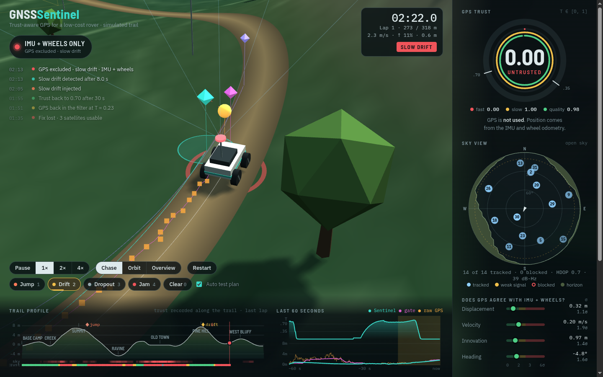
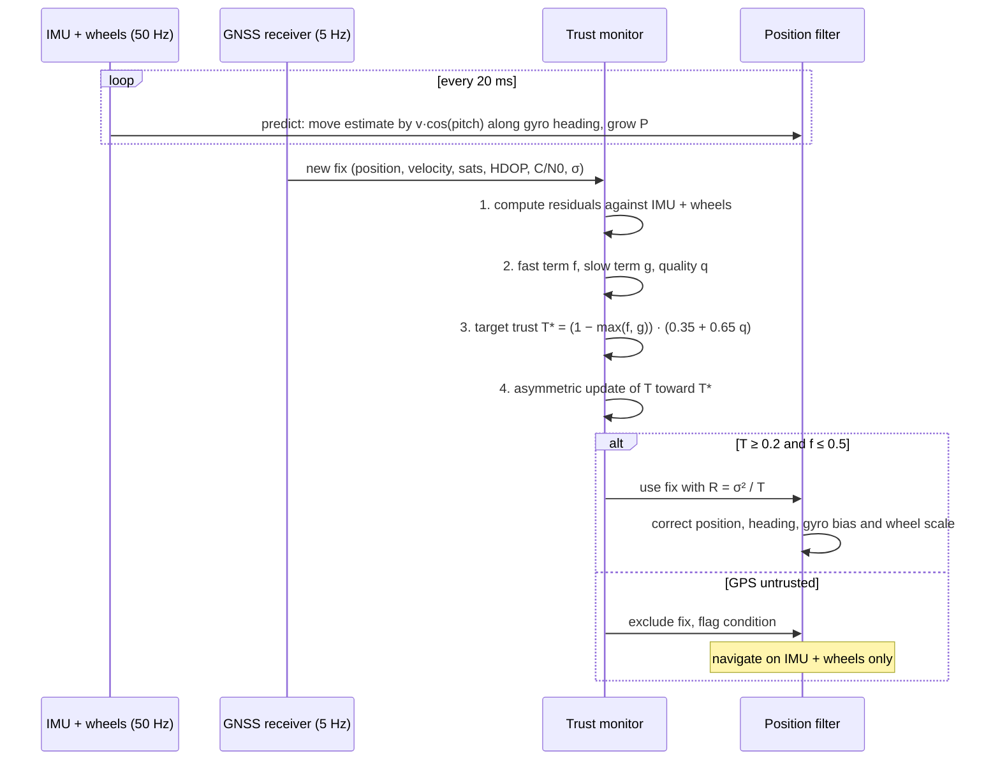
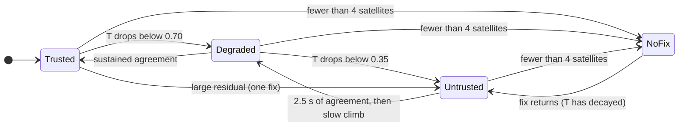
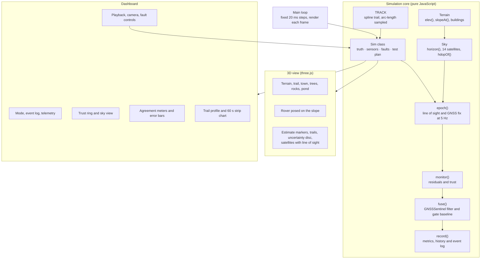

# GNSSSentinel

**A low-cost GNSS health monitor for small autonomous rovers, shown as an interactive 3D simulation.**

**Live demo:** https://bhavarth257.github.io/gnss-sentinel/

Small robots usually trust their GPS position completely, even when the fix is weak, drifting, blocked by terrain or spoofed. GNSSSentinel keeps asking *"how much should I trust my GPS right now?"* It answers with a continuous **trust level T between 0 and 1** and uses that number to decide how much the rover's position estimate should lean on GPS versus its own IMU and wheel sensors.

The simulation drives a rover along a 318 m trail with real highs and lows: a rocky pass up to a summit, a deep ravine, a town with tall buildings, a pine-covered hill and a west bluff. Each satellite is blocked or visible by actual line of sight against that terrain, so GPS degrades where it would in the field. You can inject GPS faults while it runs and compare GNSSSentinel against raw GPS, a conventional threshold gate, and pure dead reckoning.

> **Note:** all sensor data in this demo is simulated. Noise, bias and fault magnitudes are modelled on a low-cost receiver, wheel encoders and a MEMS IMU. These are not field logs.

---

## Contents

1. [Running it](#running-it)
2. [The dashboard](#the-dashboard)
3. [System architecture](#system-architecture)
4. [Inputs and outputs](#inputs-and-outputs)
5. [How the system works](#how-the-system-works)
6. [The simulated world](#the-simulated-world)
7. [Fault injection and test plan](#fault-injection-and-test-plan)
8. [Results from the simulation](#results-from-the-simulation)
9. [Software structure](#software-structure)
10. [Parameters](#parameters)
11. [Limitations](#limitations)

---

## Running it

Open the [live demo](https://bhavarth257.github.io/gnss-sentinel/), or download `index.html` and open it in any modern browser. It is a single file with no build step. It needs an internet connection the first time to load three.js and the fonts from public CDNs.

| Control | Action |
|---|---|
| Drag / scroll | Orbit and zoom the camera |
| **Chase** / **Orbit** / **Overview** | Follow the rover, circle it slowly, or view the whole trail |
| **1×  2×  4×** | Simulation speed |
| `Space` | Pause / play |
| `1` `2` `3` `4` | Inject jump, slow drift, dropout, jamming (press again to stop) |
| `0` | Clear all faults |
| **Auto test plan** | Injects faults at fixed points on the trail, alternating between two laps |

---

## The dashboard

The 3D scene fills the screen and the instruments float over it:

| Instrument | What it shows |
|---|---|
| **Navigation mode** (top left) | *GNSS + IMU fusion*, *IMU leading*, or *IMU + wheels only*, with the reason in plain words, for example "terrain blocks 36% of satellites" |
| **Event log** (top left) | Faults injected, faults detected and how fast, GPS excluded and readmitted, trust recovered |
| **Telemetry** (top right) | Time, lap, distance along the trail, speed, grade and elevation |
| **Trust ring** | Outer ring is the trust level T. Inner rings are the fast term, slow term and receiver quality. Ticks mark 0.35 and 0.70 |
| **Sky view** | Polar plot of all 14 satellites (tracked, weak or blocked) and the horizon silhouette of terrain and buildings around the rover |
| **Agreement meters** | Each residual on a 0 to 6σ scale: displacement, velocity, innovation and heading |
| **Position error** | RMSE bars for all four estimators, plus detection delay, recovery time, false alarms and time on IMU |
| **Trail profile** (bottom) | Elevation of the whole trail with landmarks, where the sky is blocked, the trust recorded on the last pass, test-plan points and the rover |
| **Last 60 seconds** (bottom) | Trust over time above, position error of each estimator below, with fault periods shaded |

In the 3D view, lines run from the rover's antenna to every satellite: blue when tracked, amber when the signal is weak, dashed red when terrain or a building blocks it.

---

## System architecture

GNSSSentinel sits between the rover's sensors and its position filter. It never trusts one source blindly. Instead it cross-checks GPS against the rover's own motion sensors, turns the disagreement into a trust level, and feeds that trust level into the filter.

*Solid arrows are data flow. Dashed orange arrows are effects the simulated world has on the GNSS signal. The dashed blue arrow is the feedback loop between dead reckoning and the filter. The red arrow is the path taken when GPS is excluded. Source: [`docs/architecture.dot`](docs/architecture.dot) (Graphviz).*

The system has five layers:

1. **Simulation world** (orange). The terrain and trail, the rover's true motion, a sky model and a fault injector:
   - The **sky model** computes the horizon around the antenna from the terrain and buildings, then decides which of 14 satellites are visible.
   - The **fault injector** corrupts the GNSS signal on demand with a position jump, a slow drift, a dropout or jamming.
2. **Onboard sensors** (yellow). The three low-cost sensors a small rover already carries: a GNSS receiver, wheel encoders and an IMU. Nothing extra is added.
3. **GNSSSentinel** (blue). The contribution of this project. It works in three stages:
   - **Dead reckoning:** tracks the rover from wheels + IMU.
   - **Residuals:** compare GPS with that motion.
   - **Trust update:** turns the disagreement, plus receiver quality, into a trust level T.

   The **position filter** then uses GPS with noise scaled by 1/T. The **exclusion check** drops GPS entirely when trust is very low, and the rover navigates on IMU + wheels alone.
4. **Baselines** (purple). Raw GPS, a conventional threshold gate, and IMU + wheels only. They run on exactly the same sensor data, so the comparison is fair.
5. **Outputs and dashboard** (green). The navigation output (position, uncertainty, trust, state and navigation mode) drives the 3D view, the dashboard and the error metrics.

---

## Inputs and outputs

### Inputs

| Input | Source | Rate | Used for |
|---|---|---|---|
| GNSS position (x, y) | Receiver | 5 Hz | Filter update, displacement and innovation residuals |
| GNSS velocity (Doppler) | Receiver | 5 Hz | Velocity, speed and heading residuals, slow drift detector |
| Satellites in use | Receiver | 5 Hz | Receiver quality q |
| HDOP | Receiver | 5 Hz | Receiver quality q, expected noise σ |
| C/N0 (signal strength) | Receiver | 5 Hz | Receiver quality q |
| Reported accuracy σ | Receiver | 5 Hz | Normalising residuals, filter noise R |
| Wheel speed | Wheel encoders | 50 Hz | Dead reckoning, velocity and displacement residuals |
| Yaw rate | IMU gyro | 50 Hz | Heading for dead reckoning |
| Pitch | IMU accelerometer | 50 Hz | Converting distance along a slope to horizontal distance |

### Outputs

| Output | Range | Meaning |
|---|---|---|
| **Trust level T** | 0 to 1 | How much GPS should be believed right now |
| **Trust state** | Trusted / Degraded / Untrusted / No fix | T ≥ 0.70, 0.35 to 0.70, < 0.35, or no satellite fix |
| **Position estimate** | metres | Fused estimate of where the rover is |
| **Position uncertainty** | metres | 2σ circle drawn around the estimate |
| **Navigation mode** | GNSS + IMU / IMU leading / IMU + wheels only | Which sensors are actually steering the estimate |
| **GPS excluded flag** | true / false | Raised when T < 0.2 or the fast term is above 0.5 |
| **Diagnostics** | | Fast term f, slow term g, quality q, each residual, R inflation (1/T), cause of the current degradation |

---

## How the system works

Every GPS reading (5 times a second) goes through the same pipeline.

### Step 1: residuals (does GPS agree with how the rover is actually moving?)

Four independent checks. Each is normalised by its expected noise, so a value of about 1σ is normal and 3σ or more is suspicious.

| Residual | Compares | Catches |
|---|---|---|
| **Displacement** | GPS movement over the last 2 s vs movement measured by wheels + IMU over the same 2 s | Sudden jumps, multipath near slopes and walls |
| **Velocity** | GPS Doppler velocity vector vs wheel speed along the gyro heading | Spoofed drift, speed errors |
| **Heading** | GPS course over ground vs integrated gyro yaw | Direction errors |
| **Innovation** | GPS position vs the filter's predicted position | Persistent offsets after a jump |

Using *displacement over a window* instead of absolute position is what makes cheap sensors good enough. Wheel and gyro errors grow slowly, so over 2 seconds they are very accurate even though they drift over minutes. The expected noise of each residual also grows with the filter's heading uncertainty, so a long stretch on IMU alone doesn't make honest GPS look wrong.

### Step 2: the fast term and the slow term

**Fast term f** reacts to obvious, recent disagreement. It takes the largest residual, smooths it a little and maps 3σ to 6σ onto 0 to 1:

$$f_s \leftarrow 0.6\,f_s + 0.4\,\max(r_d, r_v, r_i), \qquad f = \mathrm{clamp}\!\left(\frac{f_s - 3}{3},\,0,\,1\right)$$

**Slow term g** is the part aimed at creeping drift, where no single reading looks wrong. It keeps exponentially weighted averages of two things:
- the velocity residual *vector*, so small errors that keep pointing the same way add up while random noise cancels out;
- the *speed* residual. Speed can't be absorbed by heading corrections, which matters on a winding trail.

A one-sided CUSUM then accumulates evidence over time:

$$\mathbf{m} \leftarrow 0.96\,\mathbf{m} + 0.04\,(\mathbf{v}_{GPS} - \mathbf{v}_{wheel}), \qquad m_s \leftarrow 0.96\,m_s + 0.04\,(|\mathbf{v}_{GPS}| - v_{wheel})$$

$$z = \max\!\left(\frac{|\mathbf{m}|}{\sigma_m},\ \frac{|m_s|}{\sigma_s}\right), \qquad S \leftarrow \mathrm{clamp}(S + z - 1.7,\ 0,\ 24), \qquad g = \mathrm{clamp}(S / 12,\ 0,\ 1)$$

The CUSUM is armed after a 15 s start-up calibration, during which the wheel scale is learned.

**Receiver quality q** is supporting evidence from the receiver itself:

$$q = \sqrt[3]{\;\mathrm{clamp}\!\left(\tfrac{sats - 4}{6}\right)\cdot \mathrm{clamp}\!\left(\tfrac{4 - HDOP}{3}\right)\cdot \mathrm{clamp}\!\left(\tfrac{C/N_0 - 24}{16}\right)}$$

### Step 3: target trust

$$T^* = \big(1 - \max(f, g)\big)\cdot\big(0.35 + 0.65\,q\big)$$

Disagreement can push trust all the way to zero. Poor receiver quality alone can only lower it to 0.35, because a weak signal is a warning, not proof the position is wrong.

### Step 4: asymmetric update (fall fast, recover slowly)

- **Falling:** `T ← T + 0.7·(T* − T)` on every fix. A clear fault drops trust within one or two readings (0.2 to 0.4 s).
- **Recovering:** only after **2.5 seconds** of continuous agreement (f < 0.05 and g < 0.05), and then only at `T ← T + 0.05·(T* − T)` per fix (time constant about 4 s).
- **No fix:** T decays with a 6 s time constant, so a returning signal has to earn trust back.
- **Re-anchoring:** suppose GPS has been excluded for more than 20 s but has matched the IMU + wheels motion for 8 s in a row, with the slow term quiet. Then the monitor concludes its own estimate is what drifted. It opens up the estimate's uncertainty and lets GPS pull it back. A spoofed jump lasts too briefly to trigger this.

This asymmetry stops a flaky or spoofed signal from regaining full trust the moment it starts looking normal again.

### Step 5: using T in the position filter

The filter treats GPS measurement noise as larger when trust is lower:

$$R = \frac{\sigma_{GPS}^2}{\max(T,\ 0.05)}, \qquad K = \frac{P}{P + R}$$

| Trust | Effect |
|---|---|
| T = 1.0 | GPS used at its reported accuracy, estimate follows GPS |
| T = 0.5 | GPS noise treated as 2× larger (variance), IMU + wheels carry more weight |
| T < 0.2, or f > 0.5 | GPS excluded completely, rover navigates on **IMU + wheels only**, condition flagged |

While GPS is trusted, its course over ground also corrects the gyro heading and slowly **learns the gyro bias and the wheel scale**. That makes dead reckoning much better during the next outage.

### What happens along the trail

1. **Climbing:** the **IMU pitch** converts wheel distance (measured along the slope) into horizontal distance: `v_h = v_wheel · cos(pitch)`.
2. **Sky masking is computed, not scripted:**
   - At every fix, the sky model traces the horizon in 36 directions around the antenna, against the terrain and the buildings.
   - A satellite below that horizon, or below the 10° mask, is blocked.
   - HDOP is computed from the geometry of the satellites that remain.
3. **Highs are good and lows are bad:**
   - On the summit and Pine hill the sky is clear.
   - In the rocky pass, the ravine and between the town's buildings, 4 to 11 of 14 satellites are blocked.
   - Under the pine canopy, low satellites become weak rather than blocked.
4. **Multipath:** next to a blocking slope or wall, reflected signals push the fix away from the obstruction by up to about 2.8 m. The receiver **does not report** this error, which is exactly the kind of quiet error GNSSSentinel is built to catch.
5. **IMU takes over:** the displacement and innovation residuals disagree with the wheels + IMU, and quality drops. Trust falls, and the navigation mode switches to **IMU + wheels**. The mode label names the cause.
6. **Back in open sky:** trust is earned back gradually and GPS takes over again.

---

## The simulated world

| Feature | Model |
|---|---|
| Trail | 318 m closed loop, a Catmull-Rom spline through 15 waypoints, resampled every 0.1 m |
| Elevation | −4.8 m (ravine floor) to +7.5 m (summit); steepest grade 40 % |
| **Summit and rocky pass** | 7.5 m hill; four rock crags around it, three of them lining the climb, block low satellites |
| **Ravine** | The trail runs along a 5 m deep trench with 7.5 m walls on both sides |
| **Old town** | 14 buildings, 8 to 20 m tall, either side of the street |
| **Pine hill** | 7 m hill under forest canopy that weakens low satellites |
| **West bluff** | 15 m bluff west of the trail |
| Satellites | 14, at elevations from 11° to 72°, drifting slowly in azimuth |
| Signal strength | C/N0 = 31 + 16·sin(elevation) dB-Hz, minus canopy and jamming losses; below 28 dB-Hz a satellite is weak |
| GPS error | HDOP × (0.32 m + 0.025 m per dB-Hz below 42), as a slowly varying (τ = 15 s) part plus white noise, plus unreported multipath |
| Rover speed | Up to 2.8 m/s, slower in tight turns and on steep grades |
| Wheel encoders | 1.5 % scale error, 0.03 m/s noise |
| Gyro | 0.06 °/s bias left after start-up calibration, 0.01 rad/s noise |
| IMU pitch | 0.35° noise |

Four position estimates run side by side on the same sensor data:

| Estimator | Colour | Description |
|---|---|---|
| Ground truth | white | The rover itself |
| Raw GPS | orange dots | Receiver output, unfiltered |
| **GNSSSentinel** | teal | IMU + wheels fused with GPS weighted by trust T |
| Threshold gate | pink | Conventional baseline: accept a fix if it is inside a 99 % χ² gate, otherwise reject it |
| IMU + wheels only | violet | Pure dead reckoning, never corrected |

---

## Fault injection and test plan

| Fault | Key | What it does | Duration |
|---|---|---|---|
| Sudden jump | `1` | Position steps 8 m in a random direction | 15 s |
| Slow drift | `2` | Spoofer drags position at 0.12 m/s; velocity is spoofed consistently | 35 s |
| GPS dropout | `3` | No fix at all | 12 s |
| Jamming | `4` | C/N0 falls by up to 24 dB-Hz, so satellites drop out one by one until the fix is lost | 16 s |

The auto test plan starts each fault at a fixed point on the trail, in open sky, so its effect is not mixed up with terrain masking. Laps alternate:

| Lap | At 86 m (summit descent) | At 238 m / 250 m (past Pine hill) |
|---|---|---|
| 1, 3, 5 … | Sudden jump | Slow drift (at 238 m) |
| 2, 4, 6 … | GPS dropout | Jamming (at 250 m) |

The terrain adds its own degradation on every lap: the rocky pass, the ravine and the town. The trail profile at the bottom of the dashboard marks each test-plan point.

The dashboard tracks these metrics live:

- Position error RMSE and maximum for every estimator
- **Detection delay:** fault start until T < 0.5 (not measured if trust was already low when the fault started)
- **Recovery time:** fault end until T > 0.7
- **False alarms:** T < 0.5 with no fault and no environmental cause
- **Time on IMU + wheels** and the number of terrain takeovers

---

## Results from the simulation

Headless runs of 660 s (just over four laps) with five random seeds:

| Estimator | RMSE (m) | Max error (m) |
|---|---|---|
| Raw GPS | 2.3 | 8.3 to 8.8 |
| Threshold gate | 1.8 to 4.1 | 4.6 to 10.6 |
| **GNSSSentinel** | **0.7 to 1.2** | **1.9 to 4.0** |
| IMU + wheels only | 16.8 to 19.6 | 34.5 to 41.5 |

| Fault | Detected in (10 injections each) |
|---|---|
| Sudden jump | 0.0 to 0.1 s |
| Jamming | 1.6 to 3.1 s |
| Slow drift | 2.0 to 17.4 s |

- **False alarms:** none in any run.
- **Slow drift** is where the threshold gate fails:
  - It keeps accepting the slowly moving fixes and ends up several metres off.
  - When the drift stops, it *rejects* the correct GPS, so it stays wrong for a long time afterwards.
- **Recovery time** after a fault is as short as about 6 s in open sky. It is longer (up to about 50 s) when the fault ends just before the ravine or the town, because the terrain keeps GPS degraded.
- **Time on IMU + wheels:** about 52 to 56 % of the run. This includes the injected faults and every pass through the rocky pass, the ravine and the town.

These numbers come from simulated data and are meant to show the behaviour of the method. They are not a substitute for field results.

---

## Software structure

Everything is in `index.html`. The simulation core has no DOM or graphics code, so it can also be run headless in Node.js for testing and tuning.

| Part | Where in `index.html` |
|---|---|
| Simulation core | Between the `// CORE-START` and `// CORE-END` markers |
| 3D scene | After `// ===== 3D scene and dashboard =====` |
| Dashboard and controls | After `// ===== dashboard =====` |

The simulation runs at a fixed 50 Hz step regardless of frame rate, so results don't depend on the viewer's computer.

---

## Parameters

| Parameter | Value |
|---|---|
| Simulation step | 20 ms (50 Hz) |
| GNSS rate | 5 Hz |
| Elevation mask | 10° |
| Horizon sampling | 36 directions, out to 70 m |
| Displacement window | 2 s |
| Fast term range | 3σ to 6σ, smoothing 0.6 |
| Slow term EWMA weight β | 0.04 (about 5 s) |
| CUSUM allowance / cap / threshold | 1.7 / 24 / 12, armed after 15 s |
| Trust fall rate | 0.7 per fix |
| Trust recovery rate | 0.05 per fix, after 2.5 s agreement |
| No-fix trust decay | time constant 6 s |
| Re-anchoring | after 20 s excluded and 8 s of consistent fixes |
| GPS exclusion | T < 0.2 or f > 0.5 |
| Trust states | Trusted ≥ 0.70, Degraded ≥ 0.35, Untrusted < 0.35 |
| Heading correction gain | 0.035 × T per fix |
| Gyro bias learning gain | 0.0005 × T per fix |
| Wheel scale learning gain | 0.02 during calibration, then 0.0005 × T while both terms are quiet |
| Baseline gate | χ² < 9.21 (99 %, 2 degrees of freedom) |
| Multipath bias | up to 2.8 m, away from the main obstruction |

---

## Limitations

- **Dead reckoning still drifts.** On IMU + wheels alone, error grows with distance, so long outages need GPS (or another sensor) eventually.
- **Wheel slip and IMU quality matter.** Mud, sand or a poor IMU will widen the residuals and make the monitor less sensitive.
- **A sophisticated spoofer** that fakes signals consistent with the rover's real motion is out of scope.
- **Simulated data only.** The thresholds here were tuned on the simulation. A real rover needs them re-tuned on logged data from open-sky, urban, tree and hill runs.
