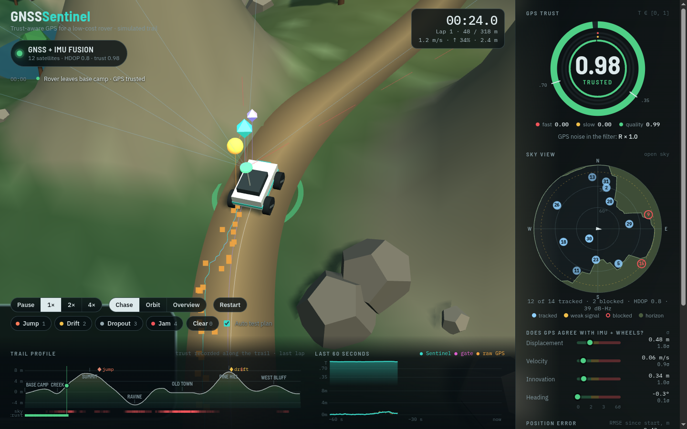
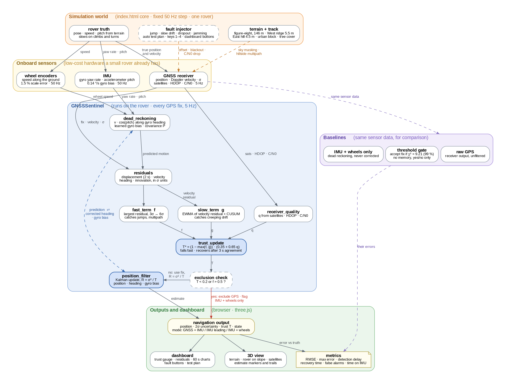
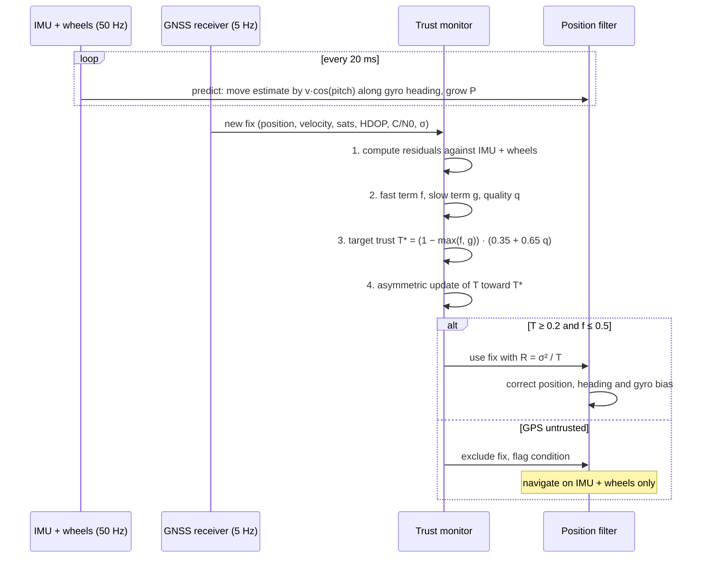
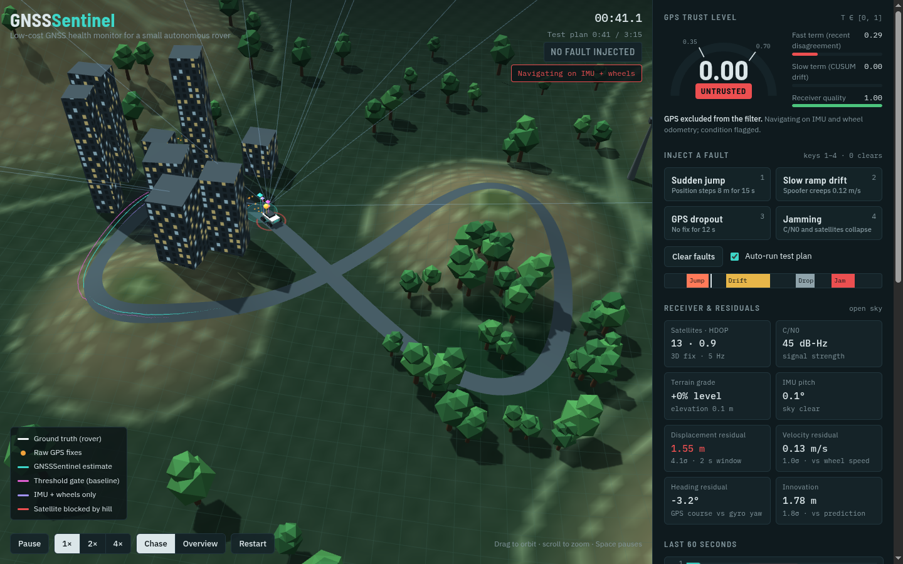
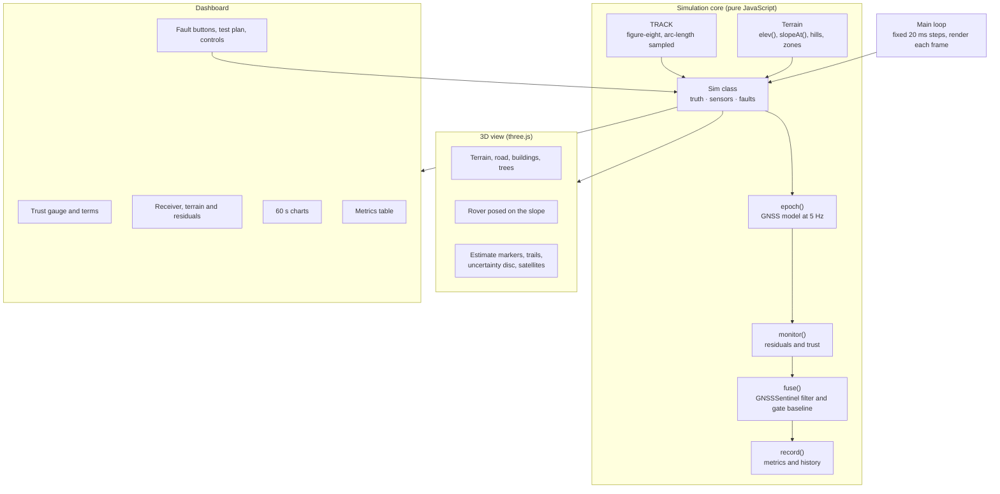

# GNSSSentinel

**A low-cost GNSS health monitor for small autonomous rovers, shown as an interactive 3D simulation.**

**Live demo:** https://bhavarth257.github.io/gnss-sentinel/

Small robots usually trust their GPS position completely, even when the fix is weak, drifting, blocked by terrain or spoofed. GNSSSentinel keeps asking *"how much should I trust my GPS right now?"* It answers with a continuous **trust level T between 0 and 1** and uses that number to decide how much the rover's position estimate should lean on GPS versus its own IMU and wheel sensors.

The simulation drives a rover around a figure-eight course with two hills, a stretch of tall buildings and a patch of tree cover. You can inject GPS faults while it runs and compare GNSSSentinel against raw GPS, a conventional threshold gate, and pure dead reckoning.

> **Note:** all sensor data in this demo is simulated. Noise, bias and fault magnitudes are modelled on a low-cost receiver, wheel encoders and a MEMS IMU. These are not field logs.

---

## Contents

1. [Running it](#running-it)
2. [System architecture](#system-architecture)
3. [Inputs and outputs](#inputs-and-outputs)
4. [How the system works](#how-the-system-works)
5. [The simulated world](#the-simulated-world)
6. [Fault injection and test plan](#fault-injection-and-test-plan)
7. [Results from the simulation](#results-from-the-simulation)
8. [Software structure](#software-structure)
9. [Parameters](#parameters)
10. [Limitations](#limitations)

---

## Running it

Open the [live demo](https://bhavarth257.github.io/gnss-sentinel/), or download `index.html` and open it in any modern browser. It is a single file with no build step. It needs an internet connection the first time to load three.js and the fonts from public CDNs.

| Control | Action |
|---|---|
| Drag / scroll | Orbit and zoom the camera |
| **Chase** / **Overview** | Follow the rover, or view the whole course |
| **1×  2×  4×** | Simulation speed |
| `Space` | Pause / play |
| `1` `2` `3` `4` | Inject jump, slow drift, dropout, jamming (press again to stop) |
| `0` | Clear all faults |
| **Auto-run test plan** | Runs the scripted 3 min 15 s fault sequence on a loop |

---

## System architecture

GNSSSentinel sits between the rover's sensors and its position filter. It never trusts one source blindly. Instead it cross-checks GPS against the rover's own motion sensors, turns the disagreement into a trust level, and feeds that trust level into the filter.

*Solid arrows are data flow. Dashed orange arrows are effects the simulated world has on the GNSS signal. The dashed blue arrow is the feedback loop between dead reckoning and the filter. The red arrow is the path taken when GPS is excluded. Source: [`docs/architecture.dot`](docs/architecture.dot) (Graphviz).*

The system has five layers:

1. **Simulation world** (orange). The course, the terrain with its two hills, the urban block and tree cover, and the rover's true motion. The fault injector corrupts the GNSS signal on demand: it can add a position jump, a slow drift, a dropout or jamming. The hills affect the GNSS signal on their own, through sky masking and hillside multipath.
2. **Onboard sensors** (yellow). The three low-cost sensors a small rover already carries: a GNSS receiver, wheel encoders and an IMU. Nothing extra is added.
3. **GNSSSentinel** (blue). The contribution of this project. It works in three stages:
   - **Dead reckoning:** tracks the rover from wheels + IMU.
   - **Residuals:** compare GPS with that motion.
   - **Trust update:** turns the disagreement, plus receiver quality, into a trust level T.

   The **position filter** then uses GPS with noise scaled by 1/T. The **exclusion check** drops GPS entirely when trust is very low, and the rover navigates on IMU + wheels alone.
4. **Baselines** (purple). Raw GPS, a conventional threshold gate, and IMU + wheels only. They run on exactly the same sensor data, so the comparison is fair.
5. **Outputs and dashboard** (green). The navigation output (position, uncertainty, trust, state and navigation mode) drives the 3D view, the dashboard and the error metrics.

---

## Inputs and outputs

### Inputs

| Input | Source | Rate | Used for |
|---|---|---|---|
| GNSS position (x, y) | Receiver | 5 Hz | Filter update, displacement and innovation residuals |
| GNSS velocity (Doppler) | Receiver | 5 Hz | Velocity and heading residuals, slow drift detector |
| Satellites in use | Receiver | 5 Hz | Receiver quality q |
| HDOP | Receiver | 5 Hz | Receiver quality q, expected noise σ |
| C/N0 (signal strength) | Receiver | 5 Hz | Receiver quality q |
| Reported accuracy σ | Receiver | 5 Hz | Normalising residuals, filter noise R |
| Wheel speed | Wheel encoders | 50 Hz | Dead reckoning, velocity and displacement residuals |
| Yaw rate | IMU gyro | 50 Hz | Heading for dead reckoning |
| Pitch | IMU accelerometer | 50 Hz | Converting distance along a slope to horizontal distance |

### Outputs

| Output | Range | Meaning |
|---|---|---|
| **Trust level T** | 0 to 1 | How much GPS should be believed right now |
| **Trust state** | Trusted / Degraded / Untrusted / No fix | T ≥ 0.70, 0.35 to 0.70, < 0.35, or no satellite fix |
| **Position estimate** | metres | Fused estimate of where the rover is |
| **Position uncertainty** | metres | 2σ circle drawn around the estimate |
| **Navigation mode** | GNSS + IMU / IMU leading / IMU + wheels only | Which sensors are actually steering the estimate |
| **GPS excluded flag** | true / false | Raised when T < 0.2 or the fast term is above 0.5 |
| **Diagnostics** | | Fast term f, slow term g, quality q, each residual, R inflation (1/T) |

---

## How the system works

Every GPS reading (5 times a second) goes through the same pipeline.

### Step 1: residuals (does GPS agree with how the rover is actually moving?)

Four independent checks. Each is normalised by its expected noise, so a value of about 1σ is normal and 3σ or more is suspicious.

| Residual | Compares | Catches |
|---|---|---|
| **Displacement** | GPS movement over the last 2 s vs movement measured by wheels + IMU over the same 2 s | Sudden jumps, multipath on hills |
| **Velocity** | GPS Doppler velocity vector vs wheel speed along the gyro heading | Spoofed drift, speed errors |
| **Heading** | GPS course over ground vs integrated gyro yaw | Direction errors (shown on the dashboard) |
| **Innovation** | GPS position vs the filter's predicted position | Persistent offsets after a jump |

Using *displacement over a window* instead of absolute position is what makes cheap sensors good enough. Wheel and gyro errors grow slowly, so over 2 seconds they are very accurate even though they drift over minutes.

### Step 2: the fast term and the slow term

**Fast term f** reacts to obvious, recent disagreement. It takes the largest residual, smooths it a little and maps 3σ to 6σ onto 0 to 1:

$$f_s \leftarrow 0.6\,f_s + 0.4\,\max(r_d, r_v, r_i), \qquad f = \mathrm{clamp}\!\left(\frac{f_s - 3}{3},\,0,\,1\right)$$

**Slow term g** is the part aimed at creeping drift, where no single reading looks wrong. It keeps an exponentially weighted average of the velocity residual *vector*, so small errors that keep pointing the same way add up while random noise cancels out. A one-sided CUSUM then accumulates evidence over time:

$$\mathbf{m} \leftarrow 0.96\,\mathbf{m} + 0.04\,(\mathbf{v}_{GPS} - \mathbf{v}_{wheel}), \qquad z = \frac{|\mathbf{m}|}{\sigma_m}$$

$$S \leftarrow \mathrm{clamp}(S + z - 1.7,\ 0,\ 24), \qquad g = \mathrm{clamp}(S / 12,\ 0,\ 1)$$

**Receiver quality q** is supporting evidence from the receiver itself:

$$q = \sqrt[3]{\;\mathrm{clamp}\!\left(\tfrac{sats - 4}{6}\right)\cdot \mathrm{clamp}\!\left(\tfrac{4 - HDOP}{3}\right)\cdot \mathrm{clamp}\!\left(\tfrac{C/N_0 - 24}{16}\right)}$$

### Step 3: target trust

$$T^* = \big(1 - \max(f, g)\big)\cdot\big(0.35 + 0.65\,q\big)$$

Disagreement can push trust all the way to zero. Poor receiver quality alone can only lower it to 0.35, because a weak signal is a warning, not proof the position is wrong.

### Step 4: asymmetric update (fall fast, recover slowly)

- **Falling:** `T ← T + 0.7·(T* − T)` on every fix. A clear fault drops trust within one or two readings (0.2 to 0.4 s).
- **Recovering:** only after **3 seconds** of continuous agreement (f < 0.05 and g < 0.05), and then only at `T ← T + 0.035·(T* − T)` per fix (time constant about 6 s).
- **No fix:** T decays with a 6 s time constant, so a returning signal has to earn trust back.

This asymmetry stops a flaky or spoofed signal from regaining full trust the moment it starts looking normal again.

### Step 5: using T in the position filter

The filter treats GPS measurement noise as larger when trust is lower:

$$R = \frac{\sigma_{GPS}^2}{\max(T,\ 0.05)}, \qquad K = \frac{P}{P + R}$$

| Trust | Effect |
|---|---|
| T = 1.0 | GPS used at its reported accuracy, estimate follows GPS |
| T = 0.5 | GPS noise treated as 2× larger (variance), IMU + wheels carry more weight |
| T < 0.2, or f > 0.5 | GPS excluded completely, rover navigates on **IMU + wheels only**, condition flagged |

While GPS is trusted, its course over ground also corrects the gyro heading and slowly **learns the gyro bias**. That makes dead reckoning much better during the next outage.

### What happens on a hill

1. As the rover climbs, the **IMU pitch** is used to convert wheel distance (measured along the slope) into horizontal distance: `v_h = v_wheel · cos(pitch)`.
2. The hillside blocks part of the sky. Satellites drop from about 12 to about 4 or 5, HDOP rises and C/N0 falls. In the 3D view, blocked satellites are drawn with red lines.
3. Signals reflecting off the slope pull the GPS fix downhill by up to about 3 m. The receiver **does not report** this error, which is exactly the kind of quiet error GNSSSentinel is built to catch.
4. The displacement and innovation residuals disagree with the wheels + IMU, and quality drops. Trust falls, and the navigation mode switches to **IMU + wheels**.
5. Over the crest and back in open sky, trust is earned back gradually and GPS takes over again.

---

## The simulated world

| Feature | Model |
|---|---|
| Course | Figure-eight, 146 m per lap: x = 24 sin u, y = 12 sin 2u |
| Rover speed | Up to 2.3 m/s, slower in tight turns and up steep grades |
| **West ridge** | 5.5 m high Gaussian hill, steepest grade about 26° |
| **East hill** | 4.5 m high Gaussian hill, steepest grade about 23° |
| Urban block | Tall buildings: fewer satellites, higher HDOP, more noise |
| Tree cover | Moderate attenuation |
| GPS error | Slowly varying Gauss-Markov error (τ = 15 s) plus white noise, both scaled by HDOP |
| Wheel encoders | 1.5 % scale error, 0.03 m/s noise |
| Gyro | 0.14 °/s bias, 0.01 rad/s noise |
| IMU pitch | 0.35° noise |

Four position estimates run side by side on the same sensor data:

| Estimator | Colour | Description |
|---|---|---|
| Ground truth | white | The rover itself |
| Raw GPS | orange dots | Receiver output, unfiltered |
| **GNSSSentinel** | teal | IMU + wheels fused with GPS weighted by trust T |
| Threshold gate | pink | Conventional baseline: accept a fix if it is inside a 99 % χ² gate, otherwise reject it |
| IMU + wheels only | violet | Pure dead reckoning, never corrected |

---

## Fault injection and test plan

| Fault | Key | What it does | Duration |
|---|---|---|---|
| Sudden jump | `1` | Position steps 8 m in a random direction | 15 s |
| Slow ramp drift | `2` | Spoofer drags position at 0.12 m/s; velocity is spoofed consistently | 35 s |
| GPS dropout | `3` | No fix at all | 12 s |
| Jamming | `4` | C/N0 falls by up to 22 dB-Hz, satellites drop, noise grows until the fix is lost | 16 s |

The auto test plan repeats every 3 min 15 s: **jump at 0:20, drift at 0:55, dropout at 1:58, jamming at 2:30.** The hills, buildings and trees add environmental degradation on every lap.

The dashboard tracks these metrics live:

- Position error now, RMSE and maximum for every estimator
- **Detection delay:** fault start until T < 0.5
- **Recovery time:** fault end until T > 0.7
- **False alarms:** T < 0.5 with no fault and no environmental cause
- **Hill IMU takeovers** and **total time on IMU + wheels**

---

## Results from the simulation

Headless runs of 340 s (just under two passes through the test plan) with three different random seeds:

| Estimator | RMSE (m) | Max error (m) |
|---|---|---|
| Raw GPS | 3.8 to 4.2 | 10.2 to 13.3 |
| Threshold gate | 1.9 to 3.3 | 4.2 to 7.3 |
| **GNSSSentinel** | **1.4 to 1.7** | **2.8 to 3.7** |
| IMU + wheels only | 8.6 to 9.4 | 18.7 to 20.6 |

- **Sudden jump:** detected on the first faulty fix (0.2 s).
- **Slow drift:** detected about 5 s after the spoofer starts. The threshold gate is the clearest failure case here. It keeps accepting the slowly moving fixes, ends up 4 m or more off, and then *rejects* the correct GPS once the drift stops, so it stays wrong for a long time afterwards.
- **Jamming and dropout:** handled through receiver quality and trust decay. Recovery takes about 9 to 10 s.
- **False alarms:** none in any run.

These numbers come from simulated data and are meant to show the behaviour of the method. They are not a substitute for field results.

---

## Software structure

Everything is in `index.html`. The simulation core has no DOM or graphics code, so it can also be run headless in Node.js for testing and tuning.

| Part | Where in `index.html` |
|---|---|
| Simulation core | Between the `// CORE-START` and `// CORE-END` markers |
| 3D scene | After `// ===== 3D scene and dashboard =====` |
| Dashboard and controls | After `// ===== dashboard =====` |

The simulation runs at a fixed 50 Hz step regardless of frame rate, so results don't depend on the viewer's computer.

---

## Parameters

| Parameter | Value |
|---|---|
| Simulation step | 20 ms (50 Hz) |
| GNSS rate | 5 Hz |
| Displacement window | 2 s |
| Fast term range | 3σ to 6σ, smoothing 0.6 |
| Slow term EWMA weight β | 0.04 (about 5 s) |
| CUSUM allowance / cap / threshold | 1.7 / 24 / 12 |
| Trust fall rate | 0.7 per fix |
| Trust recovery rate | 0.035 per fix, after 3 s agreement |
| No-fix trust decay | time constant 6 s |
| GPS exclusion | T < 0.2 or f > 0.5 |
| Trust states | Trusted ≥ 0.70, Degraded ≥ 0.35, Untrusted < 0.35 |
| Heading correction gain | 0.08 × T per fix |
| Gyro bias learning gain | 0.0004 × T per fix |
| Baseline gate | χ² < 9.21 (99 %, 2 degrees of freedom) |
| Hill masking | starts at 20 % slope, full at 34 % |
| Hill multipath bias | up to 3.2 m, downhill |

---

## Limitations

- **Dead reckoning still drifts.** On IMU + wheels alone, error grows with distance, so long outages need GPS (or another sensor) eventually.
- **Wheel slip and IMU quality matter.** Mud, sand or a poor IMU will widen the residuals and make the monitor less sensitive.
- **A sophisticated spoofer** that fakes signals consistent with the rover's real motion is out of scope.
- **Simulated data only.** The thresholds here were tuned on the simulation. A real rover needs them re-tuned on logged data from open-sky, urban, tree and hill runs.
